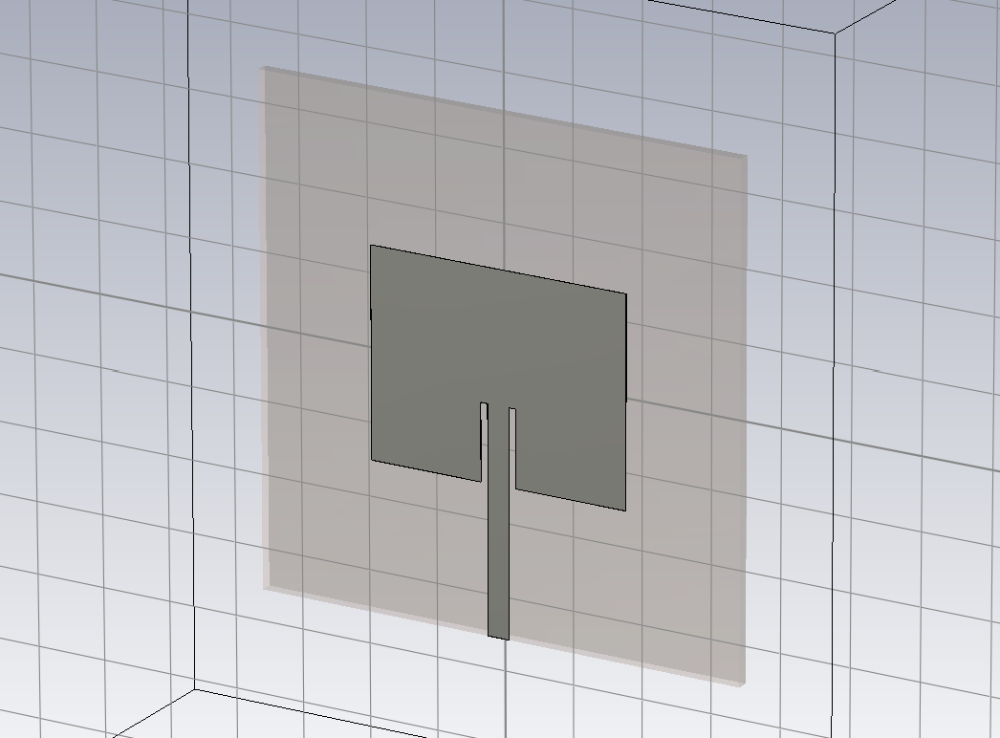
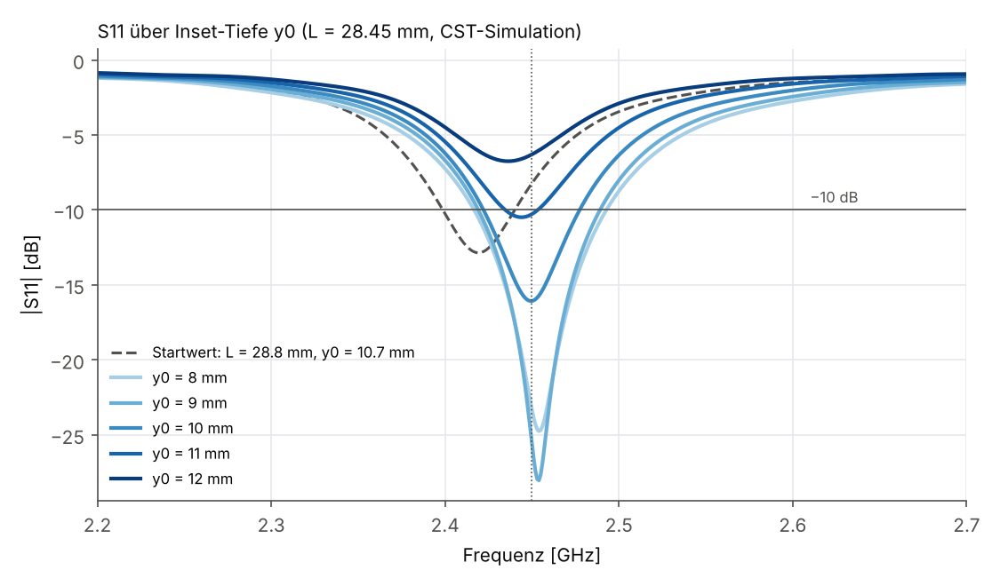

# Patchantenne 2,45 GHz auf FR-4

Rechteckige Mikrostreifen-Patchantenne mit Inset-Speisung für das 2,4-GHz-ISM-Band:
von der Entwurfsrechnung über die 3D-Feldsimulation in **CST Studio Suite** bis zur
Fertigung als Leiterplatte und zur Messung am Netzwerkanalysator.

> Status: 🟡 Simulation abgeschlossen – Layout, Fertigung und Messung offen



## Ziel

| Größe | Ziel |
|---|---|
| Mittenfrequenz | 2,45 GHz |
| Anpassung | $S_{11}$ < −10 dB im Band, an 50 Ω |
| Substrat | FR-4, 1,6 mm, 2 Lagen (JLCPCB-Standard) |
| Anschluss | SMA, Randmontage |

FR-4 ist für 2,45 GHz kein gutes HF-Material (hohe Verluste, $\varepsilon_r$ nur
ungefähr bekannt). Es ist hier bewusst gewählt: billig, überall zu fertigen, und die
Abweichungen zwischen Rechnung, Simulation und Messung werden deutlich sichtbar.

## Vorgehen

1. **Entwurfsrechnung** mit dem Transmission-Line-Modell → [`calc/patch_design.py`](calc/patch_design.py)
2. **Feldsimulation** in CST (Zeitbereichslöser), Abgleich von Länge und Inset-Tiefe → [`docs/simulation.md`](docs/simulation.md)
3. **Layout** und Fertigung (offen)
4. **Messung** von $S_{11}$ am VNA, Vergleich mit der Simulation (offen)

## Ergebnisse der Simulation

| | Handrechnung ($\varepsilon_r$ = 4,4) | Simulation, abgeglichen |
|---|---|---|
| Patchbreite $W$ | 37,2 mm | 37,2 mm |
| Patchlänge $L$ | 28,8 mm | **28,5 mm** |
| Inset-Tiefe $y_0$ | 10,7 mm | **8,5 mm** |
| Leitungsbreite (50 Ω) | 3,08 mm | 3,08 mm |
| Resonanzfrequenz | 2,45 GHz (Soll) | 2,45 GHz |
| $S_{11}$ bei Resonanz | – | −37 dB |
| Bandbreite ($S_{11}$ < −10 dB) | – | ≈ 70 MHz |
| Richtwirkung | – | 6,8 dBi |
| Strahlungswirkungsgrad | – | 39 % (−4,1 dB) |
| Gewinn | – | ≈ 2,7 dBi |



Mit den Maßen aus der Handrechnung lag die simulierte Resonanz bei 2,42 GHz
(1,2 % zu tief) mit nur −13 dB Anpassung. Die Länge ließ sich direkt proportional
korrigieren. Die Inset-Tiefe weicht dagegen um über 2 mm vom $\cos^2$-Modell ab und
wurde per Parameter-Sweep bestimmt.

## Ordner

```
calc/          Entwurfsrechnung (Python)
simulation/    CST-Exporte und Auswerteskript
hardware/      Layout und Fertigungsdaten (offen)
measurements/  VNA-Messungen (offen)
docs/          Dokumentation und Bilder
```

## Werkzeuge

CST Studio Suite 2026 (Learning Edition) · Python (NumPy, SciPy, Matplotlib) · Altium Designer

## Lizenz

MIT, siehe [LICENSE](LICENSE).
