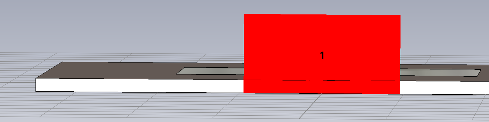
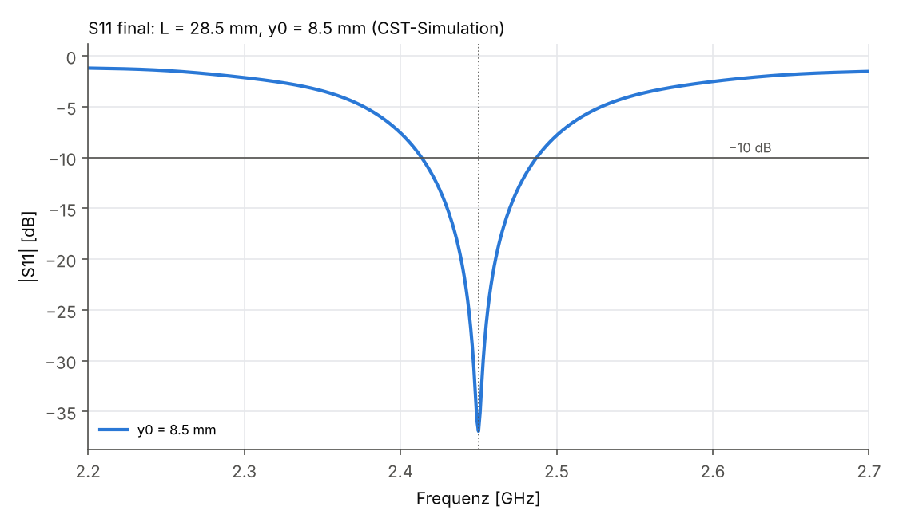
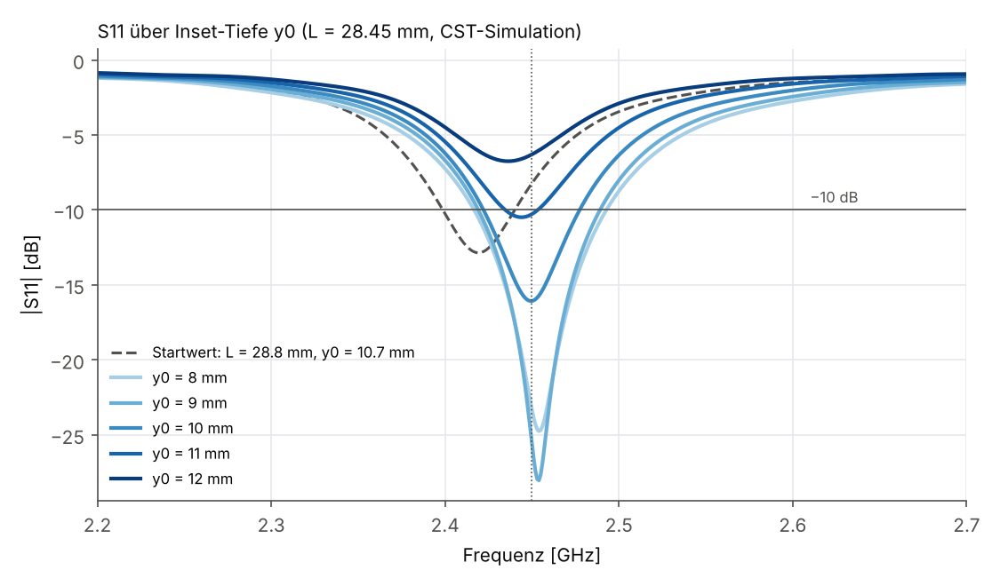
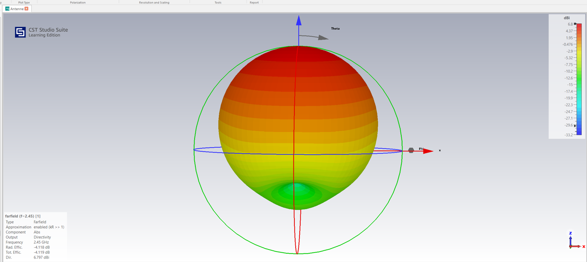

# Feldsimulation in CST Studio Suite

## Modell

| Teil | Abmessung | Material |
|---|---|---|
| Massefläche | 70 × 70 mm, 35 µm | PEC |
| Substrat | 70 × 70 × 1,6 mm | FR-4 (lossy) aus der CST-Bibliothek, $\varepsilon_r$ = 4,3, $\tan\delta$ = 0,025 |
| Patch mit Inset und Speiseleitung | $W$ × $L$, Leitung 3,08 mm, Spalt 1 mm | PEC |

Alle Maße sind als Parameter angelegt (`W`, `L`, `y0`, `wf`, `g`, `h`, `t`, `Ws`, `Ls`).
Die Patchlänge `L` liegt in y-Richtung, die Speiseleitung kommt von der Kante bei −y.

**Löser:** Zeitbereich, 2 … 3 GHz, offene Ränder. Ein Gauß-Puls wird am Port
eingespeist, aus eingespeistem und reflektiertem Signal folgt per Fourier-Transformation
$S_{11}(f)$ für das ganze Band in einem Lauf.

**Port:** Waveguide Port an der Stirnfläche der Speiseleitung. Die Portfläche reicht
unten bis zur Massefläche und ist seitlich und nach oben um je 5 · $h$ erweitert, damit
das Feld der Mikrostreifenmode vollständig erfasst wird.

## Abgleich

Rohdaten: [`simulation/results/s11_sweep_y0.txt`](../simulation/results/s11_sweep_y0.txt),
Auswertung: [`simulation/auswertung_s11.py`](../simulation/auswertung_s11.py)

| Lauf | $L$ | $y_0$ | Resonanz | $S_{11}$ | Impedanz bei Resonanz | Bandbreite |
|---|---|---|---|---|---|---|
| 1 (Handrechnung) | 28,8 mm | 10,7 mm | 2,419 GHz | −12,9 dB | 32 Ω | 41 MHz |
| 2 | 28,45 mm | 8 mm | 2,454 GHz | −24,7 dB | 54 Ω | 75 MHz |
| 3 | 28,45 mm | 9 mm | 2,454 GHz | −28,0 dB | 47 Ω | 69 MHz |
| 4 | 28,45 mm | 10 mm | 2,449 GHz | −16,1 dB | 37 Ω | 54 MHz |
| 5 | 28,45 mm | 11 mm | 2,444 GHz | −10,5 dB | 27 Ω | 18 MHz |
| 6 | 28,45 mm | 12 mm | 2,436 GHz | −6,7 dB | 18 Ω | – |
| **7 (final)** | **28,5 mm** | **8,5 mm** | **2,450 GHz** | **−36,9 dB** | **51,0 + j0,8 Ω** | **73 MHz** (2,414 … 2,487 GHz) |

Daten Lauf 7: [`simulation/results/s11_final.txt`](../simulation/results/s11_final.txt).
CST-Projekt: [`simulation/Antenne.cst`](../simulation/Antenne.cst) (nur Modell und Einstellungen; die Ergebnisse entstehen beim erneuten Rechnen).

**Schritt 1, Frequenz über $L$:** Die Resonanzfrequenz ist umgekehrt proportional zur
Patchlänge. Aus 2,419 GHz bei 28,8 mm folgt $L = 28{,}8 \cdot 2{,}419/2{,}45 \approx 28{,}45$ mm.

**Schritt 2, Anpassung über $y_0$:** Die Eingangsimpedanz fällt von der Patchkante zur
Mitte hin. Der Sweep zeigt das direkt: 54 Ω bei 8 mm, 18 Ω bei 12 mm. 50 Ω liegen
zwischen 8 und 9 mm.

## Fernfeld bei 2,45 GHz

| Größe | Wert |
|---|---|
| Richtwirkung | 6,8 dBi |
| Strahlungswirkungsgrad | −4,12 dB (39 %) |
| Gesamtwirkungsgrad | −4,12 dB |
| Gewinn | ≈ 2,7 dBi |

Die Keule zeigt senkrecht von der Platine weg, die Massefläche unterdrückt die
Abstrahlung nach hinten. Strahlungs- und Gesamtwirkungsgrad sind praktisch gleich,
durch Fehlanpassung geht also nichts verloren.

## Erkenntnisse

1. **Das Transmission-Line-Modell trifft die Frequenz auf etwa 1 %, die Inset-Tiefe
   nicht.** Das $\cos^2$-Modell sagt 10,7 mm für 50 Ω voraus, die Simulation ergibt dort
   32 Ω. Der richtige Wert liegt bei 8,5 mm. Die Handrechnung liefert Startwerte, das
   Feintuning braucht die Feldsimulation.
2. **FR-4 kostet über die Hälfte der Leistung.** Nur 39 % werden abgestrahlt, der Rest
   wird im Substrat zu Wärme. Die Verluste verbreitern zugleich die Resonanz.
3. **Die Bandbreite ist kleiner als die Materialunsicherheit.** 73 MHz Bandbreite
   stehen einer Unsicherheit von $\varepsilon_r$ gegenüber, die die Resonanz um
   etwa ± 50 MHz verschieben kann. Für die Fertigung sind deshalb mehrere Varianten
   mit leicht unterschiedlicher Länge geplant.
